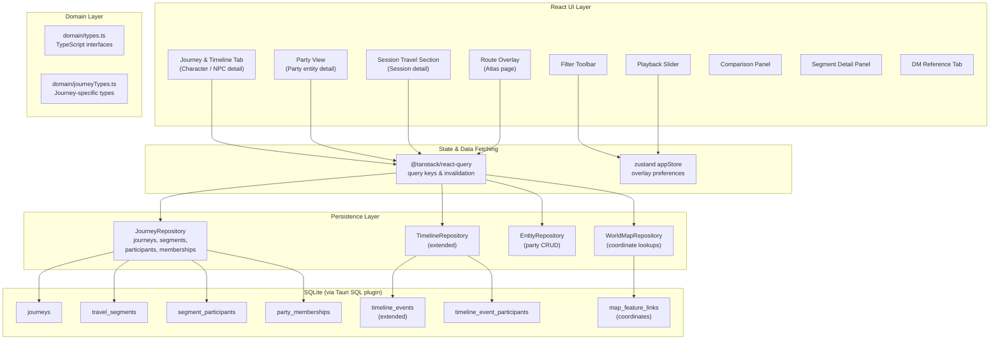
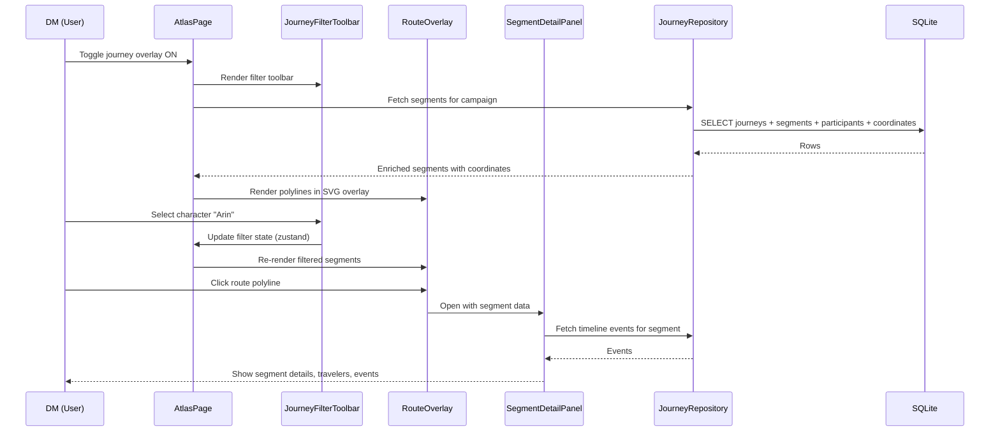

# Design Document: Character Journeys, Party Travel, and Individual Timelines

## Overview

This design introduces a unified journey model into DM Workbench that tracks the complete travel histories of characters and parties across the world atlas. A single canonical data layer powers chronological timelines, visual atlas route overlays, session travel summaries, backstory management, and character reference views.

The feature extends the existing entity, timeline, world atlas, and session systems. Five new SQLite tables (`journeys`, `travel_segments`, `segment_participants`, `party_memberships`, `timeline_event_participants`) and one ALTER TABLE on `timeline_events` provide the persistence layer. A new `JourneyRepository` class follows the established repository pattern. The `party` entity kind is registered through the existing `entities` table with no schema change — only code-level registration in `ENTITY_KINDS`, `KIND_LABELS`, `MODULE_FOR_KIND`, and routing.

The UI integrates via the existing `EntityWorkspace` / `EntityDetail` extension points (extra tabs, banners) for character, party, and session pages. The atlas overlay reuses the `dm-workbench-overlay` SVG group from `fmgBridge.ts`, extending it with route polylines, a legend panel, filter toolbar, playback slider, and comparison markers.

### Key Design Decisions

1. **Segment-level participation, not journey-level.** Participants are tracked per travel segment rather than per journey. This naturally handles party splits, temporary separations, and NPC accompaniment without requiring complex journey-splitting logic.

2. **Party as an entity kind.** Parties reuse the existing `entities` table and `entity_links` for member-of relationships. A separate `party_memberships` table adds time-awareness (join/leave session and date) on top of entity links. This keeps parties discoverable through global search and entity pickers with zero new navigation infrastructure.

3. **SVG overlay, not map data mutation.** Route polylines are rendered in the existing `dm-workbench-overlay` group inside the Azgaar iframe. Coordinates come from `map_feature_links`. This keeps route geometry stable across zoom/pan and avoids modifying the upstream map generator.

4. **Extended timeline_events, not a new table.** New columns are added to the existing `timeline_events` table (category, session_id, journey_id, segment_id, location_id, confidence, manual_order). A separate `timeline_event_participants` join table supports multi-character events. This preserves existing timeline data and avoids a competing timeline system.

5. **Forward-only migration.** All schema changes ship as a single migration (version 3) in the existing `MIGRATIONS` array, consistent with the established migration runner.

## Architecture



### Layer Responsibilities

| Layer | Responsibility |
|-------|---------------|
| **SQLite** | Schema, referential integrity, cascading deletes, indexes |
| **Repository** | SQL queries, row mapping, input validation, transaction coordination |
| **Domain Types** | TypeScript interfaces mirroring table shapes, enums for categories |
| **React Query** | Cache management, invalidation on mutations, optimistic updates |
| **zustand** | Ephemeral UI state: overlay on/off, active filters, playback position |
| **React Components** | Tabs in EntityDetail, atlas overlay rendering, filter/playback controls |

## Components and Interfaces

### New Files

| File | Purpose |
|------|---------|
| `src/domain/journeyTypes.ts` | TypeScript interfaces and type constants for journeys, segments, participants, memberships, extended timeline events |
| `src/persistence/repositories/journeys.ts` | `JourneyRepository` class with full CRUD for journeys, travel segments, segment participants, party memberships, timeline event participants |
| `src/features/characters/JourneyTimelineTab.tsx` | "Journey & Timeline" tab for PC/NPC EntityDetail |
| `src/features/characters/DmReferenceTab.tsx` | "DM Reference" tab for PC/NPC EntityDetail |
| `src/features/parties/PartiesPage.tsx` | Party EntityWorkspace with membership history, shared journeys |
| `src/features/sessions/SessionTravelTab.tsx` | "Travel" tab for session EntityDetail |
| `src/features/atlas/RouteOverlay.tsx` | Route polyline rendering, legend panel, route styling |
| `src/features/atlas/JourneyFilterToolbar.tsx` | Filter controls for character, party, session, category, date range |
| `src/features/atlas/SegmentDetailPanel.tsx` | Side panel for clicked route segment |
| `src/features/atlas/JourneyPlayback.tsx` | Timeline slider with step/jump controls |
| `src/features/atlas/RouteComparison.tsx` | Comparison panel for 2–6 characters |
| `src/features/locations/VisitHistorySection.tsx` | Visit history section for location EntityDetail |
| `src/features/journeys/JourneyEditor.tsx` | Shared journey/segment/participant editor dialog |

### Modified Files

| File | Change |
|------|--------|
| `src/domain/types.ts` | Add `"party"` to `ENTITY_KINDS`, `KIND_LABELS`; add `GEOGRAPHIC_KINDS` unchanged |
| `src/app/routes.ts` | Add `party: "parties"` to `MODULE_FOR_KIND`; add nav item |
| `src/app/router.tsx` | Add `/parties`, `/parties/:id` routes |
| `src/persistence/migrations.ts` | Append migration version 3 |
| `src/persistence/repositories/index.ts` | Export `JourneyRepository`; add to `Repositories` interface and `createRepositories` |
| `src/persistence/repositories/misc.ts` | Extend `TimelineRepository` with participant methods and enriched queries |
| `src/features/characters/CharactersPage.tsx` | Add `JourneyTimelineTab` and `DmReferenceTab` to extras.tabs |
| `src/features/sessions/SessionsPage.tsx` | Add `SessionTravelTab` to extras.tabs |
| `src/features/atlas/AtlasPage.tsx` | Add journey overlay toggle, embed `RouteOverlay`, `JourneyFilterToolbar`, `SegmentDetailPanel`, `JourneyPlayback`, `RouteComparison` |
| `src/features/locations/LocationsPage.tsx` | Add `VisitHistorySection` to extras.tabs |

### Component Interaction



### Entity Detail Tab Integration

The existing `EntityDetail` component accepts an `extras.tabs` array. Each module page passes additional tabs:

```typescript
// CharactersPage.tsx — extended extras
extras={{
  tabs: [
    { value: "tokens", label: "On maps", render: (e) => <TokenRefs entity={e} /> },
    { value: "journey", label: "Journey & Timeline", render: (e) => <JourneyTimelineTab entity={e} /> },
    { value: "dmref", label: "DM Reference", render: (e) => <DmReferenceTab entity={e} /> },
  ],
  banner: (e) => <StatBanner entity={e} />,
}}
```

## Data Models

### Database Schema (Migration Version 3)

#### `party_memberships` Table

| Column | Type | Constraints |
|--------|------|-------------|
| id | TEXT | PRIMARY KEY |
| party_id | TEXT | NOT NULL REFERENCES entities(id) ON DELETE CASCADE |
| entity_id | TEXT | NOT NULL REFERENCES entities(id) ON DELETE CASCADE |
| role | TEXT | max 100 characters |
| joined_session_id | TEXT | REFERENCES entities(id) ON DELETE SET NULL |
| left_session_id | TEXT | REFERENCES entities(id) ON DELETE SET NULL |
| joined_year | INTEGER | nullable |
| joined_month | INTEGER | nullable |
| joined_day | INTEGER | nullable |
| left_year | INTEGER | nullable |
| left_month | INTEGER | nullable |
| left_day | INTEGER | nullable |
| notes | TEXT | DEFAULT '' |
| created_at | TEXT | NOT NULL |

Indexes: `party_memberships(party_id)`, `party_memberships(entity_id)`

#### `journeys` Table

| Column | Type | Constraints |
|--------|------|-------------|
| id | TEXT | PRIMARY KEY |
| campaign_id | TEXT | NOT NULL REFERENCES entities(id) ON DELETE CASCADE |
| party_id | TEXT | REFERENCES entities(id) ON DELETE SET NULL |
| session_id | TEXT | REFERENCES entities(id) ON DELETE SET NULL |
| name | TEXT | NOT NULL |
| category | TEXT | NOT NULL (one of Journey_Category values) |
| description | TEXT | DEFAULT '' |
| dm_notes | TEXT | DEFAULT '' |
| route_certainty | TEXT | NOT NULL DEFAULT 'known' |
| start_year | INTEGER | nullable |
| start_month | INTEGER | nullable |
| start_day | INTEGER | nullable |
| end_year | INTEGER | nullable |
| end_month | INTEGER | nullable |
| end_day | INTEGER | nullable |
| sort_order | INTEGER | NOT NULL DEFAULT 0 |
| created_at | TEXT | NOT NULL |
| updated_at | TEXT | NOT NULL |

Indexes: `journeys(campaign_id)`, `journeys(party_id)`, `journeys(session_id)`

#### `travel_segments` Table

| Column | Type | Constraints |
|--------|------|-------------|
| id | TEXT | PRIMARY KEY |
| journey_id | TEXT | NOT NULL REFERENCES journeys(id) ON DELETE CASCADE |
| origin_entity_id | TEXT | REFERENCES entities(id) ON DELETE SET NULL |
| destination_entity_id | TEXT | REFERENCES entities(id) ON DELETE SET NULL |
| waypoints | TEXT | NOT NULL DEFAULT '[]' (JSON array, max 50 entries) |
| start_year | INTEGER | nullable |
| start_month | INTEGER | nullable |
| start_day | INTEGER | nullable |
| end_year | INTEGER | nullable |
| end_month | INTEGER | nullable |
| end_day | INTEGER | nullable |
| sort_order | INTEGER | NOT NULL DEFAULT 0 |
| route_certainty | TEXT | NOT NULL DEFAULT 'confirmed' |
| notes | TEXT | DEFAULT '' |
| created_at | TEXT | NOT NULL |
| updated_at | TEXT | NOT NULL |

Indexes: `travel_segments(journey_id)`

#### `segment_participants` Table

| Column | Type | Constraints |
|--------|------|-------------|
| id | TEXT | PRIMARY KEY |
| segment_id | TEXT | NOT NULL REFERENCES travel_segments(id) ON DELETE CASCADE |
| entity_id | TEXT | NOT NULL REFERENCES entities(id) ON DELETE CASCADE |
| role | TEXT | NOT NULL DEFAULT 'traveler' (max 64 characters) |
| notes | TEXT | DEFAULT '' (max 2000 characters) |
| created_at | TEXT | NOT NULL |

Unique constraint: `(segment_id, entity_id)`
Indexes: `segment_participants(segment_id)`, `segment_participants(entity_id)`

#### `timeline_event_participants` Table

| Column | Type | Constraints |
|--------|------|-------------|
| id | TEXT | PRIMARY KEY |
| event_id | TEXT | NOT NULL REFERENCES timeline_events(id) ON DELETE CASCADE |
| entity_id | TEXT | NOT NULL REFERENCES entities(id) ON DELETE CASCADE |
| role | TEXT | NOT NULL DEFAULT '' (max 100 characters) |
| created_at | TEXT | NOT NULL |

Unique constraint: `(event_id, entity_id, role)`

#### ALTER TABLE `timeline_events`

New columns added to the existing table:

| Column | Type | Default |
|--------|------|---------|
| category | TEXT | DEFAULT 'general' |
| session_id | TEXT | nullable (REFERENCES entities ON DELETE SET NULL) |
| journey_id | TEXT | nullable (REFERENCES journeys ON DELETE SET NULL) |
| segment_id | TEXT | nullable (REFERENCES travel_segments ON DELETE SET NULL) |
| location_id | TEXT | nullable (REFERENCES entities ON DELETE SET NULL) |
| confidence | TEXT | DEFAULT 'certain' |
| manual_order | INTEGER | DEFAULT 0 |

### Migration SQL (Version 3)

```sql
-- Party memberships (time-aware)
CREATE TABLE IF NOT EXISTS party_memberships (
  id TEXT PRIMARY KEY,
  party_id TEXT NOT NULL REFERENCES entities(id) ON DELETE CASCADE,
  entity_id TEXT NOT NULL REFERENCES entities(id) ON DELETE CASCADE,
  role TEXT NOT NULL DEFAULT '',
  joined_session_id TEXT REFERENCES entities(id) ON DELETE SET NULL,
  left_session_id TEXT REFERENCES entities(id) ON DELETE SET NULL,
  joined_year INTEGER,
  joined_month INTEGER,
  joined_day INTEGER,
  left_year INTEGER,
  left_month INTEGER,
  left_day INTEGER,
  notes TEXT NOT NULL DEFAULT '',
  created_at TEXT NOT NULL
);
CREATE INDEX IF NOT EXISTS idx_memberships_party ON party_memberships(party_id);
CREATE INDEX IF NOT EXISTS idx_memberships_entity ON party_memberships(entity_id);

-- Journeys
CREATE TABLE IF NOT EXISTS journeys (
  id TEXT PRIMARY KEY,
  campaign_id TEXT NOT NULL REFERENCES entities(id) ON DELETE CASCADE,
  party_id TEXT REFERENCES entities(id) ON DELETE SET NULL,
  session_id TEXT REFERENCES entities(id) ON DELETE SET NULL,
  name TEXT NOT NULL,
  category TEXT NOT NULL,
  description TEXT NOT NULL DEFAULT '',
  dm_notes TEXT NOT NULL DEFAULT '',
  route_certainty TEXT NOT NULL DEFAULT 'known',
  start_year INTEGER,
  start_month INTEGER,
  start_day INTEGER,
  end_year INTEGER,
  end_month INTEGER,
  end_day INTEGER,
  sort_order INTEGER NOT NULL DEFAULT 0,
  created_at TEXT NOT NULL,
  updated_at TEXT NOT NULL
);
CREATE INDEX IF NOT EXISTS idx_journeys_campaign ON journeys(campaign_id);
CREATE INDEX IF NOT EXISTS idx_journeys_party ON journeys(party_id);
CREATE INDEX IF NOT EXISTS idx_journeys_session ON journeys(session_id);

-- Travel segments
CREATE TABLE IF NOT EXISTS travel_segments (
  id TEXT PRIMARY KEY,
  journey_id TEXT NOT NULL REFERENCES journeys(id) ON DELETE CASCADE,
  origin_entity_id TEXT REFERENCES entities(id) ON DELETE SET NULL,
  destination_entity_id TEXT REFERENCES entities(id) ON DELETE SET NULL,
  waypoints TEXT NOT NULL DEFAULT '[]',
  start_year INTEGER,
  start_month INTEGER,
  start_day INTEGER,
  end_year INTEGER,
  end_month INTEGER,
  end_day INTEGER,
  sort_order INTEGER NOT NULL DEFAULT 0,
  route_certainty TEXT NOT NULL DEFAULT 'confirmed',
  notes TEXT NOT NULL DEFAULT '',
  created_at TEXT NOT NULL,
  updated_at TEXT NOT NULL
);
CREATE INDEX IF NOT EXISTS idx_segments_journey ON travel_segments(journey_id);

-- Segment participants
CREATE TABLE IF NOT EXISTS segment_participants (
  id TEXT PRIMARY KEY,
  segment_id TEXT NOT NULL REFERENCES travel_segments(id) ON DELETE CASCADE,
  entity_id TEXT NOT NULL REFERENCES entities(id) ON DELETE CASCADE,
  role TEXT NOT NULL DEFAULT 'traveler',
  notes TEXT NOT NULL DEFAULT '',
  created_at TEXT NOT NULL,
  UNIQUE(segment_id, entity_id)
);
CREATE INDEX IF NOT EXISTS idx_seg_participants_segment ON segment_participants(segment_id);
CREATE INDEX IF NOT EXISTS idx_seg_participants_entity ON segment_participants(entity_id);

-- Timeline event participants (multi-character events)
CREATE TABLE IF NOT EXISTS timeline_event_participants (
  id TEXT PRIMARY KEY,
  event_id TEXT NOT NULL REFERENCES timeline_events(id) ON DELETE CASCADE,
  entity_id TEXT NOT NULL REFERENCES entities(id) ON DELETE CASCADE,
  role TEXT NOT NULL DEFAULT '',
  created_at TEXT NOT NULL,
  UNIQUE(event_id, entity_id, role)
);

-- Extend timeline_events with journey-related columns
ALTER TABLE timeline_events ADD COLUMN category TEXT NOT NULL DEFAULT 'general';
ALTER TABLE timeline_events ADD COLUMN session_id TEXT REFERENCES entities(id) ON DELETE SET NULL;
ALTER TABLE timeline_events ADD COLUMN journey_id TEXT REFERENCES journeys(id) ON DELETE SET NULL;
ALTER TABLE timeline_events ADD COLUMN segment_id TEXT REFERENCES travel_segments(id) ON DELETE SET NULL;
ALTER TABLE timeline_events ADD COLUMN location_id TEXT REFERENCES entities(id) ON DELETE SET NULL;
ALTER TABLE timeline_events ADD COLUMN confidence TEXT NOT NULL DEFAULT 'certain';
ALTER TABLE timeline_events ADD COLUMN manual_order INTEGER NOT NULL DEFAULT 0;
```

### TypeScript Interfaces (`src/domain/journeyTypes.ts`)

```typescript
// Journey categories
export const JOURNEY_CATEGORIES = [
  "backstory", "campaign", "individual", "party", "npc", "flashback", "uncertain"
] as const;
export type JourneyCategory = (typeof JOURNEY_CATEGORIES)[number];

export const JOURNEY_CATEGORY_LABELS: Record<JourneyCategory, string> = {
  backstory: "Backstory", campaign: "Campaign", individual: "Individual",
  party: "Party", npc: "NPC", flashback: "Flashback", uncertain: "Uncertain",
};

// Route certainty (journey-level)
export const ROUTE_CERTAINTIES = ["known", "approximate", "unknown"] as const;
export type RouteCertainty = (typeof ROUTE_CERTAINTIES)[number];

// Route certainty (segment-level)
export const SEGMENT_CERTAINTIES = ["confirmed", "estimated", "speculative"] as const;
export type SegmentCertainty = (typeof SEGMENT_CERTAINTIES)[number];

// Timeline event categories
export const TIMELINE_EVENT_CATEGORIES = [
  "birth", "backstory", "travel", "meeting", "quest", "discovery",
  "battle", "injury", "relationship", "faction", "secret", "plot_hook",
  "milestone", "residence", "general"
] as const;
export type TimelineEventCategory = (typeof TIMELINE_EVENT_CATEGORIES)[number];

// Confidence levels
export const CONFIDENCE_LEVELS = ["certain", "probable", "uncertain"] as const;
export type ConfidenceLevel = (typeof CONFIDENCE_LEVELS)[number];

// Waypoint within a travel segment
export interface Waypoint {
  entity_id: string | null;
  x?: number | null;
  y?: number | null;
}

// Journey record
export interface Journey {
  id: string;
  campaign_id: string;
  party_id: string | null;
  session_id: string | null;
  name: string;
  category: JourneyCategory;
  description: string;
  dm_notes: string;
  route_certainty: RouteCertainty;
  start_year: number | null;
  start_month: number | null;
  start_day: number | null;
  end_year: number | null;
  end_month: number | null;
  end_day: number | null;
  sort_order: number;
  created_at: string;
  updated_at: string;
}

// Travel segment
export interface TravelSegment {
  id: string;
  journey_id: string;
  origin_entity_id: string | null;
  destination_entity_id: string | null;
  waypoints: Waypoint[];
  start_year: number | null;
  start_month: number | null;
  start_day: number | null;
  end_year: number | null;
  end_month: number | null;
  end_day: number | null;
  sort_order: number;
  route_certainty: SegmentCertainty;
  notes: string;
  created_at: string;
  updated_at: string;
}

// Segment participant
export interface SegmentParticipant {
  id: string;
  segment_id: string;
  entity_id: string;
  role: string;
  notes: string;
  created_at: string;
}

// Party membership
export interface PartyMembership {
  id: string;
  party_id: string;
  entity_id: string;
  role: string;
  joined_session_id: string | null;
  left_session_id: string | null;
  joined_year: number | null;
  joined_month: number | null;
  joined_day: number | null;
  left_year: number | null;
  left_month: number | null;
  left_day: number | null;
  notes: string;
  created_at: string;
}

// Timeline event participant
export interface TimelineEventParticipant {
  id: string;
  event_id: string;
  entity_id: string;
  role: string;
  created_at: string;
}

// Extended timeline event (augmented from existing TimelineEvent)
export interface ExtendedTimelineEvent {
  id: string;
  campaign_id: string;
  entity_id: string | null;
  title: string;
  body_md: string;
  year: number | null;
  month: number | null;
  day: number | null;
  kind: string;
  secret: boolean;
  category: TimelineEventCategory;
  session_id: string | null;
  journey_id: string | null;
  segment_id: string | null;
  location_id: string | null;
  confidence: ConfidenceLevel;
  manual_order: number;
  created_at: string;
  updated_at: string;
}

// Enriched query result types (joined data for UI)
export interface EnrichedSegment extends TravelSegment {
  journey: Journey;
  participants: (SegmentParticipant & { entity_name: string })[];
  origin_name: string | null;
  destination_name: string | null;
  origin_coords: { x: number; y: number } | null;
  destination_coords: { x: number; y: number } | null;
  waypoint_coords: ({ x: number; y: number } | null)[];
}

export interface EnrichedMembership extends PartyMembership {
  entity_name: string;
  entity_kind: string;
  joined_session_name: string | null;
  left_session_name: string | null;
}
```

### JourneyRepository Interface

The `JourneyRepository` class follows the same pattern as `WorldMapRepository` and `TimelineRepository`:

```typescript
class JourneyRepository {
  constructor(private readonly db: SqlDriver) {}

  // ── Journeys ──
  async createJourney(input: JourneyInput): Promise<Journey>;
  async getJourney(id: string): Promise<Journey>;
  async updateJourney(id: string, patch: Partial<JourneyPatch>): Promise<Journey>;
  async deleteJourney(id: string): Promise<void>;
  async listJourneys(campaignId: string, filters?: JourneyFilters): Promise<Journey[]>;
  async journeysForSession(sessionId: string): Promise<Journey[]>;
  async journeysForParty(partyId: string): Promise<Journey[]>;
  async journeysForCharacter(entityId: string): Promise<Journey[]>;

  // ── Travel Segments ──
  async createSegment(input: SegmentInput): Promise<TravelSegment>;
  async getSegment(id: string): Promise<TravelSegment>;
  async updateSegment(id: string, patch: Partial<SegmentPatch>): Promise<TravelSegment>;
  async deleteSegment(id: string): Promise<void>;
  async listSegments(journeyId: string): Promise<TravelSegment[]>;
  async reorderSegments(journeyId: string, orderedIds: string[]): Promise<void>;
  async segmentsForCharacter(entityId: string): Promise<EnrichedSegment[]>;
  async segmentsForLocation(entityId: string): Promise<EnrichedSegment[]>;

  // ── Segment Participants ──
  async addParticipant(input: ParticipantInput): Promise<SegmentParticipant>;
  async removeParticipant(id: string): Promise<void>;
  async participantsForSegment(segmentId: string): Promise<SegmentParticipant[]>;

  // ── Party Memberships ──
  async addMembership(input: MembershipInput): Promise<PartyMembership>;
  async updateMembership(id: string, patch: Partial<MembershipPatch>): Promise<PartyMembership>;
  async removeMembership(id: string): Promise<void>;
  async membershipsForParty(partyId: string): Promise<EnrichedMembership[]>;
  async membershipsForCharacter(entityId: string): Promise<PartyMembership[]>;
  async activeMemberships(partyId: string): Promise<EnrichedMembership[]>;
  async membershipAtSession(partyId: string, sessionId: string): Promise<EnrichedMembership[]>;
  async membershipAtDate(partyId: string, year: number, month?: number, day?: number): Promise<EnrichedMembership[]>;
  async hasActiveMembership(partyId: string, entityId: string): Promise<boolean>;

  // ── Timeline Event Participants ──
  async addEventParticipant(eventId: string, entityId: string, role?: string): Promise<TimelineEventParticipant>;
  async removeEventParticipant(id: string): Promise<void>;
  async eventParticipants(eventId: string): Promise<TimelineEventParticipant[]>;
  async eventsForCharacter(entityId: string): Promise<ExtendedTimelineEvent[]>;

  // ── Enriched Queries (joined for UI) ──
  async enrichedSegmentsForMap(campaignId: string, mapId: string, filters?: RouteFilters): Promise<EnrichedSegment[]>;
  async characterTravelHistory(entityId: string): Promise<EnrichedSegment[]>;
  async locationVisitHistory(entityId: string): Promise<EnrichedSegment[]>;
  async sessionTravelSummary(sessionId: string): Promise<{ journey: Journey; segments: EnrichedSegment[] }[]>;
  async dmReferenceData(entityId: string, campaignId: string): Promise<DmReferenceData>;

  // ── Waypoint Cleanup (triggered on entity deletion) ──
  async removeWaypointEntity(entityId: string): Promise<void>;
}
```

### Route Overlay Rendering Approach

The route overlay extends the existing `renderOverlay` function pattern from `fmgBridge.ts`. Instead of modifying the existing function, a new `renderRouteOverlay` function renders into the same `dm-workbench-overlay` SVG group:

```typescript
// RouteOverlay.tsx — core rendering logic

interface RouteSegmentRender {
  points: { x: number; y: number }[];      // origin → waypoints → destination
  category: JourneyCategory;
  certainty: SegmentCertainty;
  segmentId: string;
  journeyId: string;
}

// Category → visual style mapping
const ROUTE_STYLES: Record<JourneyCategory, { color: string; dashArray: string }> = {
  campaign:   { color: "#22c55e", dashArray: "" },            // solid green
  party:      { color: "#3b82f6", dashArray: "" },            // solid blue
  backstory:  { color: "#a78bfa", dashArray: "12,6" },        // dashed purple
  individual: { color: "#f59e0b", dashArray: "" },            // solid amber
  npc:        { color: "#ec4899", dashArray: "" },             // solid pink
  flashback:  { color: "#8b5cf6", dashArray: "8,4,2,4" },     // dash-dot violet
  uncertain:  { color: "#6b7280", dashArray: "3,3" },          // dotted gray
};
```

Route polylines are created as SVG `<polyline>` elements inside the `dm-workbench-overlay` group. Each polyline gets:
- A transparent `<polyline>` with `stroke-width: 8` and `pointer-events: stroke` for click hit area
- A visible `<polyline>` with the category-specific color and dash pattern, `stroke-width: 2.5`
- `pointer-events: none` on the visible line so clicks fall through to the hit area

Coordinates are in Azgaar map space (from `map_feature_links`), so polylines remain aligned during zoom/pan — the same `viewbox` transform that moves burgs also moves route lines.

The legend panel and filter toolbar are rendered as React components outside the iframe, positioned as overlays on the atlas page using absolute positioning within the map container.

### Playback Mechanism

Playback state is managed in zustand:

```typescript
interface PlaybackState {
  active: boolean;
  segments: EnrichedSegment[];  // ordered playback sequence
  position: number;             // -1 = before first segment, 0..n-1 = segment index
  stepForward(): void;
  stepBackward(): void;
  jumpToSession(sessionId: string): void;
  setPosition(index: number): void;
  activate(segments: EnrichedSegment[]): void;
  deactivate(): void;
}
```

The playback ordering derives from: journey start date → journey sort_order → segment sort_order → manual_order (for undated journeys). The slider has one discrete position per filtered segment plus an initial "before first" position.

### Character Route Comparison

When 2–6 characters are selected in the filter, each character gets a unique stroke color. Shared locations (appearing in multiple selected characters' segments) get a distinct shared marker. The comparison panel is a React component listing shared locations, unique-to-subset locations, and overlapping sessions.

## Correctness Properties

*A property is a characteristic or behavior that should hold true across all valid executions of a system — essentially, a formal statement about what the system should do. Properties serve as the bridge between human-readable specifications and machine-verifiable correctness guarantees.*

### Property 1: Party membership non-overlap invariant

*For any* party and character, if there are multiple membership periods for that character in that party, no two periods overlap — where a period with no left_session_id extends indefinitely and overlap is defined by one period's join being at or before the other's leave and vice versa.

**Validates: Requirements 2.4**

### Property 2: Segment participant uniqueness

*For any* travel segment, adding the same character (entity_id) twice to that segment is rejected, and the participant list size equals the number of distinct entity_ids.

**Validates: Requirements 5.3**

### Property 3: Journey cascade delete preserves entities

*For any* journey with associated travel segments, segment participants, and timeline events, deleting the journey removes all segments and participants but leaves all referenced character, location, and session entities unchanged and all associated timeline events intact with null journey_id/segment_id.

**Validates: Requirements 3.7, 14.10**

### Property 4: Segment cascade delete preserves journey and entities

*For any* travel segment with associated participants and timeline events, deleting the segment removes participant records, sets segment_id to null on timeline events, but leaves the parent journey and all referenced entities unchanged.

**Validates: Requirements 4.7, 14.11**

### Property 5: Timeline event sorting is deterministic

*For any* set of timeline events, sorting by (manual_order ASC, year ASC NULLS LAST, month ASC NULLS LAST, day ASC NULLS LAST, created_at ASC) produces a consistent total ordering where no two events occupy the same position.

**Validates: Requirements 6.6, 6.7**

### Property 6: Segment-journey reference integrity

*For any* timeline event, if segment_id is non-null then journey_id must also be non-null. Creating or updating an event with a non-null segment_id and null journey_id is rejected.

**Validates: Requirements 6.9**

### Property 7: Travel history round-trip through character view

*For any* character added as a participant to a travel segment, querying that character's travel history returns a result set containing that segment. Conversely, removing the participant causes the segment to no longer appear in that character's travel history.

**Validates: Requirements 5.4, 7.1**

### Property 8: Party membership at-session query correctness

*For any* party with membership records and any queried session, the members returned are exactly those whose joined_session_id is at or before the queried session and whose left_session_id is null or at or after the queried session.

**Validates: Requirements 2.10**

### Property 9: Route overlay coordinate alignment

*For any* travel segment whose origin and destination entities have entries in map_feature_links, the rendered polyline endpoints use the map_feature_links (x, y) coordinates in Azgaar map coordinate space, not screen pixel coordinates.

**Validates: Requirements 17.1, 17.5**

### Property 10: Filter combination is conjunctive

*For any* combination of active filters (character, party, session, category, date range), a segment is displayed only when it satisfies every active filter simultaneously (AND logic). Clearing all filters restores the full unfiltered segment set.

**Validates: Requirements 11.7, 11.10**

### Property 11: Active membership derivation

*For any* party membership record with no left_session_id and no left date fields set, the corresponding character is treated as a current (active) member. Setting a left_session_id or left date transitions the character to past member status.

**Validates: Requirements 2.6**

### Property 12: Entity deletion cascades correctly through journey system

*For any* character entity that is a segment participant and party member, deleting the character entity removes all of that character's segment_participants rows (CASCADE) and party_memberships rows (CASCADE), while leaving the travel segments, journeys, and other participants intact.

**Validates: Requirements 5.5, 2.8**

### Property 13: Journey name validation

*For any* input string, creating a journey trims leading/trailing whitespace and requires the trimmed name to be between 1 and 200 characters. Empty strings, whitespace-only strings, and strings exceeding 200 characters after trimming are rejected.

**Validates: Requirements 3.2**

### Property 14: Waypoint entity cleanup on entity deletion

*For any* entity referenced as a waypoint in a travel segment's waypoints JSON array, deleting that entity removes the waypoint entry from the array while preserving the segment and all other waypoints.

**Validates: Requirements 4.6**

## Error Handling

### Repository Layer Errors

| Scenario | Behavior |
|----------|----------|
| Journey not found on update/delete | Throw `NotFoundError` (existing pattern from `common.ts`) |
| Duplicate segment participant | SQLite UNIQUE constraint violation caught and re-thrown as a descriptive error: "Character is already a participant on this segment" |
| Overlapping party membership | Checked in application code before INSERT: query active memberships for (party_id, entity_id); if an active record exists, throw a validation error: "Character is already an active member of this party" |
| Invalid journey_id on segment creation | Verify journey exists before INSERT; throw `NotFoundError` if missing |
| segment_id without journey_id on timeline event | Validate in repository before INSERT/UPDATE; throw validation error: "A segment cannot exist without its parent journey reference" |
| Invalid entity kind for participant | Verify entity exists and kind is `pc` or `npc` before INSERT; throw validation error |
| Journey name too long / empty | Validate trimmed length (1–200) before INSERT; throw validation error |
| Waypoints array exceeds 50 entries | Validate array length before INSERT/UPDATE; throw validation error |
| Migration failure (ignorable) | Follows existing `isIgnorableMigrationError` pattern — skip duplicate column errors |
| Migration failure (non-ignorable) | Halt migration sequence, do not record version, propagate error |

### UI Layer Error Handling

- Mutations use `useAction` (existing pattern) which shows toast notifications on error via `sonner`
- Optimistic updates on list reordering with rollback on failure
- Empty states for all views when no data exists (journey tabs, party membership, visit history, route overlay)
- Graceful handling of missing map coordinates: skip unmapped segments in overlay, show warning label
- Missing entity references in segment panel: render name as plain text without navigation link

### Data Integrity

- Foreign keys with ON DELETE CASCADE for ownership (journey→segments, segment→participants, party→memberships)
- Foreign keys with ON DELETE SET NULL for references (segment→origin/destination, journey→session, timeline_event→journey)
- Application-level validation for business rules not expressible in DDL (membership overlap, entity kind checks, name length)
- Waypoint cleanup requires an application-level trigger: when an entity is deleted, call `removeWaypointEntity(entityId)` to scrub the JSON arrays. This is wired into the entity deletion workflow.

## Testing Strategy

### Unit Tests (Vitest)

Unit tests focus on specific examples and edge cases that complement property-based testing:

- **Repository CRUD**: Create, read, update, delete for each table (journeys, segments, participants, memberships, timeline event participants)
- **Enriched queries**: Verify joined query results return correct entity names, coordinates, participant lists
- **Validation edge cases**: Empty journey name, 201-character name, 51 waypoints, duplicate participant, segment-without-journey on timeline event
- **Cascade behavior**: Delete journey → verify segments and participants removed, entities preserved, timeline events unlinked
- **Waypoint cleanup**: Delete entity → verify waypoint removed from JSON array
- **Membership overlap detection**: Exact boundary conditions for overlapping periods
- **Timeline sorting**: Events with mixed null/non-null dates, equal manual_order values
- **Migration**: Verify version 3 migration applies cleanly on top of version 2, verify idempotence with `isIgnorableMigrationError`

### Property-Based Tests (fast-check)

Property-based tests use [fast-check](https://github.com/dubzzz/fast-check) for randomized input generation. Each test runs a minimum of 100 iterations.

| Test | Property | Iterations |
|------|----------|------------|
| Membership non-overlap | Property 1 | 100 |
| Participant uniqueness | Property 2 | 100 |
| Journey cascade delete | Property 3 | 100 |
| Segment cascade delete | Property 4 | 100 |
| Timeline sorting determinism | Property 5 | 100 |
| Segment-journey reference integrity | Property 6 | 100 |
| Travel history round-trip | Property 7 | 100 |
| Membership at-session query | Property 8 | 100 |
| Filter conjunction | Property 10 | 100 |
| Active membership derivation | Property 11 | 100 |
| Entity deletion cascades | Property 12 | 100 |
| Journey name validation | Property 13 | 100 |
| Waypoint entity cleanup | Property 14 | 100 |

**Tag format**: `Feature: character-journeys, Property {N}: {title}`

Property 9 (coordinate alignment) is tested as an integration test since it requires the Azgaar iframe and SVG rendering context.

### Integration Tests

- **Atlas overlay rendering**: Verify polylines render in the correct SVG group with correct coordinates (requires iframe setup)
- **Entity deletion workflow**: End-to-end deletion of a character verifies cascades through segment_participants, party_memberships, and waypoint JSON cleanup
- **Session travel summary**: Create journey + segments + participants linked to a session; verify the session travel summary query returns the correct grouped structure
- **DM Reference derivation**: Create backstory journeys, entity links, item instances, timeline events; verify the DM reference view assembles the correct derived fields

### Test Infrastructure

- Tests use an in-memory SQLite database via the existing `SqlDriver` interface
- Migration is applied before each test suite
- `fast-check` arbitraries generate valid `Journey`, `TravelSegment`, `SegmentParticipant`, and `PartyMembership` records
- Entity fixtures (campaigns, characters, locations, sessions) are created via `EntityRepository` in test setup
